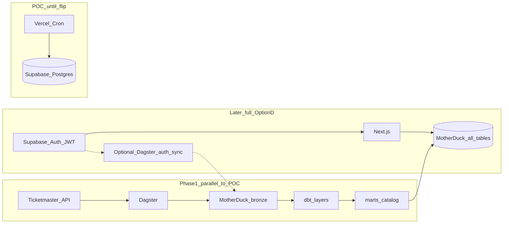

# Outsy data pipeline rebuild (Phase 1)

## Final decision

| Choice | Decision |
|--------|----------|
| Warehouse / app DB | **MotherDuck** — locked as the single store for **all** product data (catalog + social) |
| Orchestration | **Local OSS Dagster** (`dagster dev`) — locked for Phase 1 |
| Transforms | **dbt-duckdb** against MotherDuck (ingest → bronze → marts) |
| Phase 1 scope | Foundation + **Ticketmaster only** end-to-end (catalog path) |
| Product cutover | **Deferred** — POC on Supabase until later phases |
| Serving target (later) | **Option D (full):** Next.js reads/writes **MotherDuck** for events, venues, RSVPs, profiles, messages, moments, etc. Supabase **Postgres retired** as app DB |
| Identity / sessions | **Supabase Auth only** — locked. JWT (`sub` = user id) gates server routes; all business rows keyed by that id live on MotherDuck |
| User data into MD | **Serving path:** app writes profiles/social **directly** to MotherDuck (not “wait for ingest”). **Analytics path (optional later):** Dagster sync of `auth.users` / auth events into bronze for warehouse completeness |
| Dagster+ / Cloud | **Out of scope** until after local pipeline works |
| Self-hosted Docker | Optional Phase 2+ for always-on schedules; not required for Phase 1 |

### Why MotherDuck (vs Amazon and others)

| Option | Free for commercial product? | Fit for Option D + lean ops | Verdict |
|--------|------------------------------|-----------------------------|---------|
| **MotherDuck** | Yes — free tier covers Montreal-scale catalog + early social volume | Low ops; Absinthe precedent; HTTP SQL for app reads/writes | **Chosen (full app DB)** |
| **Amazon S3 + Athena** | Near-free storage; Athena billed per TB scanned (tiny $ at Outsy volume) | Good lake raw layer; weak as primary product serving DB; more IAM/Glue | Later optional raw archive only |
| **Amazon Redshift Serverless** | No lasting free tier (trial/credits then RPU cost) | Overkill for ~1k events; higher ops | Reject |
| BigQuery | Free tier yes | Awkward product serving | Reject for now |
| ClickHouse Cloud | Limited free | Strong serving, less DataCC precedent | Revisit if MD latency hurts |
| Databricks | Free Edition is non-commercial; paid for product | Overkill + cost | Reject |
| Supabase-only medallion | Free-ish | Conflicts with Option D | Reject as warehouse |

**Amazon takeaway:** useful later as a cheap **S3 raw dump** if needed; not the primary store. MotherDuck holds bronze/silver/gold **and** app/serving tables (including social).



## Target architecture (locked)

### Why keep Supabase Auth

- Already wired in the Next.js app; free tier is enough early on.
- MotherDuck has no signup/login, sessions, OAuth, or email magic links.
- Switching to Clerk/Auth0 later is possible but adds migration cost for no Phase 1 gain.
- Retire **Supabase Postgres** (tables + RLS + Realtime as source of truth); keep **Auth** as the identity plane.

### Data on MotherDuck (end state)

- **Ingest layers (dbt):** bronze → staging/intermediate → catalog marts (`events`, `venues`, organizers, …).
- **App tables (MotherDuck):** profiles, RSVPs, friendships, messages, moments, notifications, follows, handles — FK/user id = Supabase Auth `sub`.
- **Serving writes:** Next.js server routes write social/profile rows **straight to MotherDuck** after JWT check. Do not make the UI wait on a Dagster ingest for RSVPs/messages (that would feel broken).
- **Optional analytics ingest:** later Dagster job copies Auth user metadata / auth events into bronze (warehouse completeness, admin analytics) — complementary, not the live path.
- **Access pattern:** server-side MotherDuck client only; authorize in API routes / server actions from the JWT.
- **Realtime:** lost with Supabase DB cutover; add polling/SSE later if needed.

### Risks accepted (document in ADR)

- MotherDuck is stronger as analytics/lake than high-concurrency OLTP; fine at early Outsy scale.
- No Postgres RLS — app-layer authz only; never expose MD tokens to the browser.
- Two vendors (Supabase Auth + MotherDuck) until you optionally replace Auth later.

Reuse Absinthe (`DuckDBMotherDuckResource`, dbt on MotherDuck) and Oamo layering, scaled for Outsy.

## Repo layout (new under Outsy)

```text
Outsy/
  data/
    README.md
    dagster/
      outsy_dagster/
        definitions.py
        assets/ticketmaster.py
        resources/motherduck.py
      pyproject.toml
    dbt/
      dbt_project.yml
      profiles.yml.example
      models/staging/ticketmaster/
      models/intermediate/
      models/marts/events.sql
      models/marts/venues.sql
      tests/
  docs/data-architecture.md
```

Keep existing [`src/lib/ingestion-ticketmaster.ts`](src/lib/ingestion-ticketmaster.ts) and Vercel crons running until cutover.

## Phase 1 deliverables

1. **Decision doc** — ADR in `docs/data-architecture.md` (MotherDuck as sole app DB including social; Supabase Auth-only; optional auth→MD analytics sync; local OSS Dagster; Amazon/Dagster+ deferred).
2. **MotherDuck project** — schemas for bronze/staging/marts (and placeholder for future `app`/`serving` social schemas); token via env only.
3. **Local Dagster Ticketmaster asset(s)**
   - Port windowed fetch logic from [`docs/ingestion.md`](docs/ingestion.md) / TS adapter (Montreal lat/long, classifications, date windows).
   - Write raw responses to bronze (e.g. `bronze.ticketmaster_events_raw`).
   - Run via `dagster dev` / manual materialization first.
4. **dbt project**
   - staging → intermediate → `marts.events` / `marts.venues`.
   - Tests: unique `(source, source_event_id)`, not-null `start_at`, event→venue relationship where present.
5. **Local runbook** — install deps, set env, `dagster dev` + `dbt build` documented.
6. **Parity check (manual)** — sample compare mart counts/IDs vs Supabase `source='ticketmaster'` (no product flip).

**Not in Phase 1:** other sources, product cutover, social migration, stopping Vercel crons, fuzzy dedup, `locked` curation.

## Phase 2+ (outline only)

- Add Eventbrite / SAT / New City Gas as Dagster assets + dbt.
- **Catalog cutover:** discovery reads MotherDuck marts via server-side client.
- **Social cutover:** migrate profiles/RSVPs/messages/moments/… schemas to MotherDuck; rewrite app data access off Supabase Postgres; replace RLS with server authorization.
- Keep Supabase Auth; migrate app tables to MotherDuck; retire Supabase Postgres. Optional Dagster sync of auth users into bronze.
- Feature-flag cutover; disable Vercel ingest for migrated sources.
- Optional: S3 archive of bronze JSON; realtime replacement if product needs it.
- Quality: venue aliases, fuzzy event dedup, `locked` fields, freshness SLAs.

## Ops / cost defaults (locked)

- **Orchestration cost Phase 1: $0** — OSS Dagster on the developer machine only.
- **Warehouse cost Phase 1: $0** — MotherDuck free tier.
- **No Dagster+** in Phase 1 (Solo starts ~$10/mo + credits; not needed until always-on remote scheduling).
- Always-on production later: prefer self-hosted Docker Compose before paying for Dagster+.
- Secrets: `MOTHERDUCK_TOKEN`, `TICKETMASTER_API_KEY` — never in repo.
- No AWS bill required for Phase 1.

## Success criteria

- Ticketmaster raw lands in MotherDuck via Dagster.
- `dbt build` produces tested `marts.events` / `marts.venues`.
- Runbook lets a second person reproduce locally.
- ADR records MotherDuck as sole app DB (including social end state) + local Dagster; production still served by the POC until later cutover.
